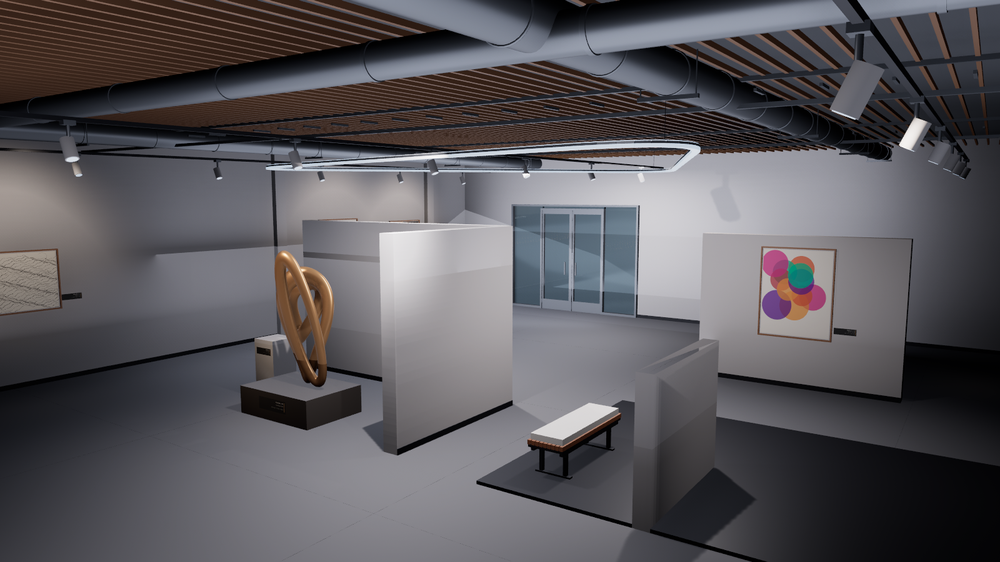
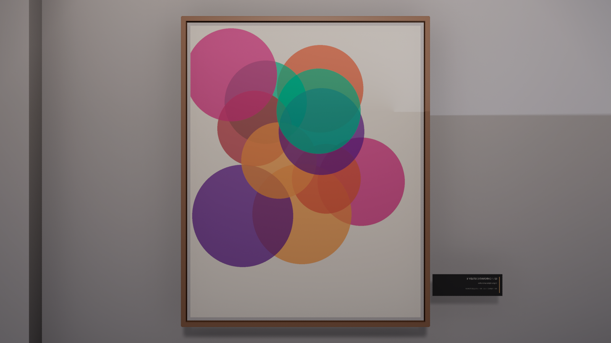

# Industrial Gallery — UE 5.8

A procedurally authored industrial art-gallery environment for Unreal Engine 5.8, built
entirely from Python builder modules and C++ gameplay code. The level is not hand-placed: it
is generated from data tables, so "rebuild the gallery" is one command and the layout provably
derives from the same tables that position the lights and cameras.



## Requirements

- Unreal Engine **5.8** at `C:/Program Files/Epic Games/UE_5.8/Engine`
- Visual Studio 2022 Build Tools with the C++ workload (MSVC)
- Python 3 with Pillow (for offline mesh/texture generation)

No engine assets beyond `/Engine/BasicShapes` are used. All meshes, artwork textures and label
textures are generated locally by `Tools/reference_props.py`; nothing is downloaded.

## Quick start

```bash
# Build the C++ module
python Tools/run_reference.py compile

# Generate the level from the builder modules
python Tools/run_reference.py author

# Run it
"C:/Program Files/Epic Games/UE_5.8/Engine/Binaries/Win64/UnrealEditor.exe" \
  "IndustrialGallery.uproject" \
  /Game/ReferenceGallery/L_ReferenceGallery -game -windowed -ResX=1600 -ResY=900
```

Controls: **WASD** walk · **mouse / arrow keys** look · **E** door · **L** toggle showcase lighting.



## Layout

| Path | Purpose |
|---|---|
| `Source/IndustrialGallery/` | C++ module: visitor pawn, interactive door, game mode, capture/probe harness |
| `Tools/build_reference.py` | Orchestrator: creates the level, shared materials, calls each module |
| `Tools/reference_layout.py` | Room shell, partitions, doorways, saved cameras |
| `Tools/reference_props.py` | Sculpture, bench, ducts, slats, artwork, offline asset generation |
| `Tools/reference_lighting.py` | Ribbon fixture, art spots, bounce fill, post-process |
| `Tools/reference_technical.py` | Interactive door, PlayerStart, ambient audio, light tagging |
| `Tools/reference_rotation.py` | Order-safe `unreal.Rotator` construction (see below) |
| `Tools/run_reference.py` | Build/author/capture/probe pipeline with stale-output guards |
| `Tools/verify_reference_transforms.py` | Read-only geometry verification against engine vectors |
| `Docs/` | One document per workstream |

## Verification

Nothing here is reported as working on the strength of an exit code.

```bash
python Tools/run_reference.py compile    # requires "Result: Succeeded" AND a DLL newer than all sources
python Tools/run_reference.py author     # rebuilds the level; asserts REFERENCE_BUILD_SUCCESS
python Tools/run_reference.py capture    # 6 screenshots, asserts the fresh-file count
python Tools/run_reference.py probe      # 16 injected-input cases + floor/spawn assertions
python Tools/measure_shots.py            # per-shot luminance distribution vs. the reference
python Tools/test_reference_runner.py    # unit-tests the runner's own gates (no engine launch)
```

`verify_reference_transforms.py` loads the saved level and asks the **engine** where things
actually point — 39 checks covering artwork uprightness and wall-facing, duct axes,
suspended-fixture horizontality, every aimed light's forward vector against its own table
target, and the PlayerStart facing. It exits non-zero if any check fails.

## The bug worth knowing about

`unreal.Rotator`'s positional argument order is **`(roll, pitch, yaw)`** — not the C++
`(pitch, yaw, roll)`. Verified against the installed engine:

```python
unreal.Rotator(0, 90, 0)   # -> pitch: 90, yaw: 0, roll: 0
```

Passing an authored C++-order tuple positionally therefore turned every intended **yaw into a
pitch**. The consequences were silent and global: wall canvases lay flat on their backs (reading
as flat grey panels), ceiling ducts pointed straight up, suspended fixtures rolled onto their
edges, and every aimed light fired along world +X instead of at its target — while every
parameter readback and the build's own success marker passed. All rotation construction now goes
through `Tools/reference_rotation.py::rot()`.

## Reference

The scene is modelled on an industrial art-gallery reference: dark polished floor, warm-grey
perimeter walls, exposed dark slatted ceiling with cylindrical ducts and track lighting, a gold
interwoven-loop sculpture on a dark plinth, a curved white partition, colourful framed abstract
artwork, and a wood-slat bench with a pale cushion.

`Assets/SplineReference/` holds recovered evidence for the linked Spline scene
(`Modern Industrial Art Gallery`), including a published runtime screenshot and the 397-object
runtime transform inventory. See `Assets/SplineReference/RECOVERY_REPORT.md` for provenance and
its revision caveat — the published export is an earlier snapshot than the editor file.

## Notes

- The original `L_IndustrialGallery` level is preserved and untouched.
- Artwork, labels and meshes are original procedurally generated content, not reproductions of
  any referenced artwork.
